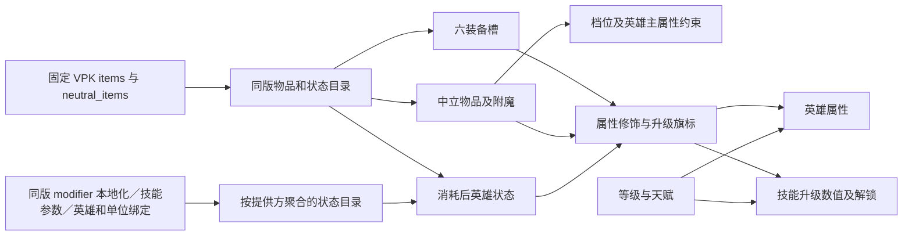

# 英雄物品和状态

英雄详情的本地阅读模拟，入口见[语义 UI](semantic-game-ui.md#英雄详情布局与等级)。不写 Catalog 或业务数据库；切换英雄／Catalog 重新开始，同英雄切换界面语言保留选择。

## 概念、对象与关系

| 层次       | 合同                                                                                              |
| ---------- | ------------------------------------------------------------------------------------------------- |
| 目标       | 查看等级、天赋、装备、升级及中立配置对当前英雄面板的影响                                          |
| 概念       | 配置、装备槽、物品、附魔、英雄状态、属性修饰、技能升级                                            |
| 对象       | 一个 HeroInventory；六个普通槽；一个中立槽及一个附魔槽；状态 ID 与来源等级；同版 InventoryCatalog |
| 关系       | 槽引用物品；物品可消费为状态；档位与主属性约束附魔候选；物品与状态贡献修饰和升级旗标              |
| 规则与事件 | 装备／替换／移除／切换模式／消费／选择状态／换档／重置，统一经过纯 reducer 校验                   |
| 展示       | 左栏简介、等级、天赋；中栏「物品和状态」；右栏派生属性；下方技能同步升级                          |

机器改动账：来源读取→显式语义映射→纯状态／投影→受控 UI；普通装备变化不重绘整本技能卡，只有升级旗标、技能／天赋及重置变化进入技能上下文。用户学习账：点击槽选择目标，搜索点击或 Enter 装备；信息图标看简介；当前状态可移除；更换中立档位清空附魔，保留同档或低档中立物品；一次重置恢复初始组合。

## 物品与价值

八槽集中排列：左侧六个普通装备槽两列三行，右侧中立物品与附魔并排，档位位于两槽上方，按当前版本可用档位常显单选按钮，支持点击和方向键，无下拉菜单；左侧装备槽跨越右侧档位行，从配置区顶端开始，与档位按钮顶边对齐；右侧中立槽下是神杖配置，神杖下拉入口按当前文字自然宽度排列，箭头紧邻文字；魔晶与银月入口左右同行；右侧配置区底边与左侧三行装备槽对齐，标题下间距8px，避免为左侧预留空档位行，底部空间用于当前状态；普通单格44px宽、48px高，无独立底框，列间距2px、行间距4px、左右区域间距4px，中栏左右内边距8px。普通物品使用32px方形对象框，中立物品与附魔使用32px圆形对象框；悬停或键盘聚焦出现细描边和浅底反馈，默认不显示描边。装备图标和名称悬停／聚焦直接显示完整物品简介及面板贡献，点击同一对象关闭详情并打开选装面板；简介与移除图标默认透明且不接收指针，悬停槽或焦点进入槽后显示；键盘可直接聚焦操作，点按对象打开搜索弹层，选装或Escape关闭后恢复对象焦点以便继续操作。选中槽以金色名称区分；图标与单行名称紧凑排列，长名称省略并保留完整名称提示和简介入口。条件控制仅在已选中立物品时显示于槽区下方，取消单独的中立标题／档位行。空槽与已装备槽等高，换装备不推动下方内容。

- 搜索入口不常驻，普通／中立／附魔均点击槽后打开非模态浮层，自动聚焦搜索框；选装、关闭按钮、Escape、点击外部或焦点离开关闭，选装／键盘关闭恢复槽位焦点。物品简介可在浮层上继续查看，Escape先关闭简介再关闭搜索。面板宽度最高760px，左右至少留8px；结果按150px最小列宽自适应为桌面四列、窄屏两列，卡片40px高，名称单行省略、简介保留全名。列表高度最高640px并随视口收缩，48项一块连续加载，在浮层内部滚动；面板限制在当前视口内；选装与开关不推动页面布局。
- 中立物品／附魔面板打开时，点击档位或用方向键切换均保持面板与搜索内容，候选和效果按新档位立即刷新；列表从头展示。档位控件属于弹层的关联交互区，其余外部点击、Escape和选装仍关闭面板。换档清空附魔及保留合规中立物品的规则不变。
- 中立物品与附魔候选卡取消价格0，常显同版本非零效果参数及两行说明摘要（零值仍保留于完整简介）；附魔参数使用当前档位投影值，名称与图标保持紧凑，完整说明保留于Hover简介。卡片按最小220px列宽自适应，桌面三列、窄屏一列，避免参数挤压；普通装备保持原价格与四列列表。
- 装备价值以金币图标及数字放在标题右侧，名称保留于无障碍文字与悬停提示；删除“正在配置第N格”和底部即时生效说明。神杖、魔晶、银月入口使用同版物品图标。
- 搜索在客户端同步完成，支持中英文、拼音、A杖／A帐／aghs／bkb 等别名；下拉复用 InfiniteList 分块，简介复用 ItemSummary／HoverTooltip，键盘与点击均可使用。
- 只把普通可购且非 recipe／obsolete 定义放入六槽；中立列表必须出现在当前版本 `neutral_items.txt` 的池中，不把历史中立定义当作当前候选。附魔使用池内的等级，不能用档位数字替代；升档可保留低档物品及其模式／再次打造次数，因此四级附魔师饰物可搭配五级附魔；按当前英雄主属性和 global 候选合并。
- 装备价值只计当前六槽，按剩余初始数量比例计费。含消耗总价值另加当前有效消费状态的配置成本；这是当前配置的等价价值，不是累计花费／退款账。中立物品与附魔价值为0；炼金赠予不计受赠英雄购入成本。
- 直接属性读同版 AbilityValues；Dagon 等物品使用 ItemBaseLevel。动力鞋有三围选项，臂章有开关，圣剑有攻击／技能增强模式，静谧之鞋有完好／破损状态。警觉附魔的攻击距离按同版 `+$attack_range_all` 文本同时作用于近战和远程。不同魔抗、闪避及冷却缩减按剩余比例结算；唯一效果按明确分组去重，普通鞋速取最高。固定三围先进入派生面板，百分比按其语义阶段处理。

## 状态与升级

当前状态统一为32px圆形图标，包括消费状态、持有神杖、中立／附魔及物品模式。常驻只展示图标，完整名称保留为可访问名称；悬停／聚焦／点击显示名称、当前模式、对应物品或状态详情，消费状态列出实际修饰及持续时间。可移除状态的删除按钮仅在悬停／聚焦时出现，键盘仍可进入并操作；派生状态随对应配置更新，不提供会与配置脱节的独立删除。

| 状态／模式       | 规则                                                                                                             |
| ---------------- | ---------------------------------------------------------------------------------------------------------------- |
| 持有 A 杖        | 占一格，同版全属性／生命／魔法加成，开启神杖升级                                                                 |
| 吞服 A 杖        | 释放装备槽，仅保留升级；配置成本按福佑5800，不保留普通神杖属性                                                   |
| 炼金赠予         | 保留神杖完整属性并开启升级，替代持有／吞服模式，不重复叠加                                                       |
| 魔晶             | 不占格，幂等状态，开启魔晶升级及对应技能解锁                                                                     |
| 银月之晶         | 装备为140攻速；吞服为60攻速、200夜间视野，最多一个吞服状态；持有与吞服攻速可相加，专属视野取最高                 |
| 吃树／药膏／净化 | 使用后减少数量或释放槽；按来源产生恢复状态，显示持续时间；保持到手动移除，不运行倒计时                           |
| 中立物品状态     | 石羽挎包羽毛／石头、决斗手套附近敌人、神秘手镯受击层数、不屈之眼敌人数、精华指环、剥皮者皮靴及蜕变颚刃的主动状态 |
| 神圣王冠         | 死亡状态禁用物品效果并移除附魔；模拟中仍可切换配置                                                               |
| 珍品强化         | 来源标记 `apply_curio_bonus` 的物品字段提高30%，不直接放大附魔                                                   |
| 附魔师饰物       | 基础附魔增幅10%，每次再次打造增加35%；来源标记的再次打造增幅可受珍品强化，换物品清除再次打造次数                 |

状态保留同版物品身份、效果字段及可核对的 modifier 身份。未在固定来源找到 modifier 名称时留空，用应用状态 ID 表达规则，不编造引擎对象。移除物品、状态、附魔或关闭升级后立即重新投影；重置清空全部装备／状态／中立配置、英雄等级与天赋，并重置技能选择。

技能卡按“当前技能等级→A杖／魔晶 modifier→天赋 modifier”投影；`+`、`-`、`*`、直接替换分别按来源运算。仅升级出现的字段以0为未升级基值；重复或无法求值的条件显示缺项。升级赋予的隐藏技能仍进入详情，明确当前解锁状态。升级效果说明保留，以涵盖改变目标、行为或附加机制的升级。

## 来源、边界与验证

来源为 Catalog 绑定的 `dota_vpk_updates` commit，7.41f／6944 为 `f4c45719314754567cb4ef4fe343bbc790a311f4`。`item-snapshot` 校验同 commit 的 steam.inf hash，再读 items.txt、neutral_items.txt 及中英本地化，provenance 保留文件 hash、仓库、commit、客户端、读取时间与适配／schema 版本。不存在中立池时明确无资料；缺失引用或无效池等级报错。未审阅 commit 不开启模拟，不借用最新版数据。

炼金赠予属性与替换既有神杖规则依据 [Valve Mistwoods](https://www.dota2.com/mistwoods?l=english)（2026-10-15核对）；数值来自同版物品字段。光环结算参考 [Aura](https://liquipedia.net/dota2/Aura) 与 [Arcane Boots](https://liquipedia.net/dota2/Arcane_Boots)（2026-10-15），同种光环唯一，不同恢复光环不合并为一个；社区机制参考仍需同版引擎抽样。

这是属性与状态阅读模拟，不是完整战斗引擎。没有时间、当前剩余生命／魔法、目标及战斗事件输入；伤害触发、敌方减益、召唤物、臂章生命流失及缺血条件不凭空增加基础面板。额外技能增强、施法距离、冷却缩减等显示为英雄属性，不宣称已经重算所有技能的目标伤害／最终消耗。特殊英雄技能覆盖由技能投影合同负责；未覆盖效果保留可见提示和同版简介。普通移速100–550、攻速20–700边界不覆盖特定技能突破上限的情况。

验证复用 `tests/unit/hero-inventory.test.ts`、等级／语言及检查映射测试；真实旅程在 `tests/journeys/catalog.spec.ts` 覆盖搜索、简介、A杖三模式、魔晶、银月、全重置、中立档位、负面属性、附魔增幅及390px。按文件 `pnpm check --plan --files ...`／`pnpm check --files ...` 选择检查，不把来源推导当作引擎验收。

## 提供方状态目录

“当前状态”标题旁增加添加按钮，打开可搜索面板。搜索框、来源筛选、目录说明及结果数量合为单行工具栏；窄屏在工具栏内横向滚动，页面不横向溢出，结果列表保留纵向空间。按提供方（具体物品、英雄、单位或建筑）聚合，提供物品／英雄／中立生物／建筑／其他单位筛选；搜索状态、提供方、技能、英文内部名、拼音及首字母，结果保留提供方与来源技能。当前版本可识别状态来自固定VPK modifier本地化，技能／参数及英雄绑定来自同Catalog，单位来自已校验的固定快照；塔防光环为显式引擎状态关联，不编造技能定义。前缀最长匹配建立的关联在详情标明，缺描述或无可识别提供方的不进入目录；中立、建筑及其他单位仅纳入已逐项识别的受作用方modifier，排除肉山自身防御、偷塔保护、信使护盾和单位变形等自用状态，光环发射器与受益状态分开；来源定义不代表当前对局完整可触发清单，也不承诺完整引擎modifier覆盖。

首次打开按需请求`/api/catalog/hero-statuses?dataset=<UUID>`，必须指定已发布可读Catalog；非法、不可用与来源缺失分别返回400／404／503，不退回默认版本。响应带环境身份、Catalog／commit和来源路径／哈希／版本，前后端缓存各限两版与20MiB；并发复用，失败可重试。搜索和筛选只操作已加载目录，InfiniteList每32个状态分块连续展示，收起保留缓存，切换英雄／版本清空选择。初次加载或失败明确显示，原消费状态仍可使用。大目录不随英雄首屏传输。

同一modifier只保留一个手动来源状态；提供方身份保留在状态ID，换提供者替换同modifier状态，不模拟多施法者堆叠。技能等级可在添加面板与当前状态详情直接选择，只接受来源允许的整数级；未知上限按参数向量确定，显式MaxLevel优先，禁止把超过上限的中立成长向量误当技能等级或自动取首项计算。添加、改级、移除、重置走同一纯reducer；外部提供的状态不计英雄装备价值。状态采用圆形来源图标，Hover显示来源链接、说明、等级、参数和面板贡献；目录名称可添加，面板支持连续添加、Escape关闭与焦点恢复。

数值只由显式modifier→字段→属性映射计算，复用原属性投影和双向分段高亮；状态描述中的运行时占位符显示“—”，不将未知值当0。首批明确映射嗜血术的受赠攻速／移速、强攻恢复／移速、炎阳纹章给予友方的护甲／攻速／移速及玄冥盾牌、恢复头巾、洞察烟斗、战鼓光环；不包含提供方天赋／升级、自身专属加成、层数、护盾承伤或施法过程。已映射光环与持有物品复用唯一组避免双算。中立技能的多成长向量与单级定义不一致时保留原参数并标未建模。其余状态可添加、查看和移除，但明确标“未计入属性”；部分映射只承诺列出的面板贡献，不把状态说明全部视为已实现。

实现入口：`domain/hero-status-catalog`、`importers/dota-vpk/hero-status-adapter`、`server/services/hero-status-catalog`、`components/hero-status-picker`。验证复用库存计算／目录旅程，新增状态目录单元覆盖已知答案、等级、重复身份、未知来源和提供方搜索；检查映射覆盖新API和各层。
