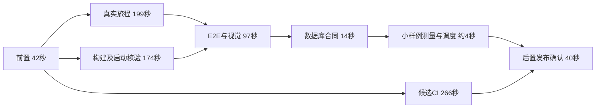

# 2026-10-19 发布耗时分析与优化方案

状态：P0及两项P1已实施并完成本机六轮对照；动态中位数274.8→262.6秒，减少12.2秒（4.4%），最慢一次未改善。CI与完整发布实测待提交／推送批准，见[实施验收](../history/2026-10-20-publication-optimization.md)。下文保留实施前的历史发布分析与收益估算，不能作为本轮已实现收益。原分析基线为功能提交`deb95e76ed292654891892476ace1d02e64b7c58`及文档提交`13ff6b6a24101e07f00c07b05f7e9e2f04a2303a`；业务快照`bee227bd`、数据提交`12bcfdff`。

## 结论与统计口径

从第一条发布命令到最终文档发布确认，历时**44分17秒**。最后一次成功的完整功能发布为**6分35秒**，随后的文档发布为**2分08秒**。完整发布的关键路径是本机动态检查314秒；候选CI266秒与它并行。main代码推送本身只耗时约4秒。

44分17秒包含失败重跑、定向检查、修复和等待，不代表正常单次发布性能。六次失败命令累计19分00秒；两次成功命令累计8分43秒；命令之间累计16分35秒。后者包含排查、修改和额外测试，不能全部记为人工操作或空闲。三项加总以毫秒原值为准，取整会有1秒差异。失败命令和间隔占整个窗口约80.3%，但并非全部可以通过脚本加速消除。

本机采用publication的`startedAt`至`updatedAt`及stage耗时；GitHub采用同一run／job内的服务端时间。两端绝对时间存在约数十秒偏差，不能直接相减推导排队时间。CI的本机等待266.137秒与GitHub历时254秒之间约12秒的差值，只能归为启动、传输和轮询等综合开销，不能精确拆分。本报告不含第一次命令前的准备，也不含最终发布后的数据回读和停机清理。

## 本轮时间线

以下为2026-10-19新加坡时间（UTC+8），起止显示到秒，耗时由原始毫秒计算。

| 起止              |  命令耗时 | 结果与原因                                          | publication ID           |
| ----------------- | --------: | --------------------------------------------------- | ------------------------ |
| 22:23:34–22:23:46 |  12.107秒 | 工作台数据库未启动，数据准备失败                    | `1792419815569-761aed73` |
| 22:24:09–22:28:24 | 254.605秒 | 首屏图片缓存被挤出；Linux搜索防抖断言失败           | `1792419850763-85f47ce7` |
| 22:35:42–22:40:52 | 309.781秒 | fixture天赋数量、返回导航、Linux移动截图失败        | `1792420543570-2a16c5cd` |
| 22:47:00–22:51:30 | 269.442秒 | 天赋首次悬停flaky；Linux桌面截图失败                | `1792421221909-480eee26` |
| 22:51:49–22:56:38 | 288.950秒 | Linux已通过；GitHub回读TLS握手超时导致本机E2E被取消 | `1792421510699-022e9656` |
| 22:57:29–23:04:04 | 395.176秒 | 完整功能发布通过                                    | `1792421851345-d2295d0f` |
| 23:05:21–23:05:26 |   4.654秒 | 验收文档缺少README索引条目                          | `1792422322982-5f756f36` |
| 23:05:44–23:07:51 | 127.666秒 | 文档发布通过                                        | `1792422345124-b38b6cc7` |

窗口为2657.276秒，命令累计1662.381秒，其中失败1139.539秒、成功522.842秒；命令间隔994.895秒。各轮修复和平台边界见[发布验收](../history/2026-10-19-main-publication.md)。本轮已完成缓存、等待条件、fixture一致性、截图基线和TLS识别修复，这些收益属于已交付成果，不再计作未来优化收益。

## 最后一次完整发布的关键路径

| 阶段                                         |      实测耗时 | 对总耗时的贡献                                                       |
| -------------------------------------------- | ------------: | -------------------------------------------------------------------- |
| 预检、静态检查、固定候选、数据准备及启动间隙 |      41.898秒 | 串行前置；其中静态16.469秒、数据准备20.058秒                         |
| 本机动态检查                                 |     313.711秒 | 当前关键路径                                                         |
| 候选CI                                       |     266.137秒 | 与本机动态并行，提前约47.574秒结束                                   |
| 候选／远端校验、数据发布、快进main、确认     |      39.567秒 | 串行后置；其中数据发布12.427秒、代码推送3.828秒、main CI确认21.300秒 |
| 总计                                         | **395.176秒** | `41.898 + max(313.711, 266.137) + 39.567`                            |

本机检查收据为`1792421892088-eb723f2a`。时间结构如下，近似秒数只用于解释依赖：

- 构建173.902秒与真实旅程198.887秒同时开始，构建提前约25秒完成。构建stage还含准备和启动核验，不能与日志中约2.1分钟的编译步骤混为一谈。
- E2E与视觉97.079秒在两者都完成后才启动，之后是数据库合同13.590秒、小样例测量0.559秒及调度间隙。两段浏览检查累计295.966秒，占动态阶段约94.3%。
- 当前调度只将真实旅程与构建配对；fixture浏览、数据库合同和测量仍串行。若允许构建完成后立即开始fixture浏览，本次轨迹最多可重叠约25秒，不能把整段97秒算成可节省时间。
- 即使本机动态降到266秒以下，其他环节不变时，整轮仍需约347.602秒，即5分48秒。要进入5分钟，需要同时优化CI或前后置阶段。

最终本机覆盖615单元、52真实旅程、32E2E与视觉、23数据库合同及构建；Linux覆盖615单元、36fixture旅程、32E2E与视觉、23数据库合同及构建，最终均无flaky。旧[发布性能记录](publication-retry-performance.md)的285.7秒来自较小范围，不能直接作为本轮退化比例的基准。

## Linux CI与文档发布

[最终功能候选CI](https://github.com/CharlesLiuyx/Medota2/actions/runs/39273862573)服务端历时254秒。plan耗时8秒；静态作业71秒，运行时作业175秒。六个浏览分片如下，均为独立host／数据库、单worker：

| 分片 | 作业总耗时 | Chromium安装 | 浏览检查步骤 |
| ---- | ---------: | -----------: | -----------: |
| 1    |      233秒 |         31秒 |        174秒 |
| 2    |      186秒 |         19秒 |        145秒 |
| 3    |      188秒 |         21秒 |        139秒 |
| 4    |      208秒 |         21秒 |        162秒 |
| 5    |      170秒 |         22秒 |        127秒 |
| 6    |      156秒 |         20秒 |        111秒 |

最慢与最快作业差77秒，浏览步骤差63秒。分片1决定CI完成时间；优先用用例耗时优化分配，再评估浏览器安装缓存。六份环境准备是隔离的成本，不能直接把所有安装时间相加当作可节省的墙钟时间。当前依赖安装约5–9秒、附件上传约1–2秒，优先级较低。

[文档候选CI](https://github.com/CharlesLiuyx/Medota2/actions/runs/39275075602)服务端53秒，本机候选等待59.971秒；静态作业30秒中实际检查只有4秒。本机文档动态阶段仅0.759秒，但数据准备17.398秒、数据发布11.654秒、main确认27.476秒，使总发布耗时127.666秒。单独文档发布的主要成本是环境准备与交接协议。

[功能main确认](https://github.com/CharlesLiuyx/Medota2/actions/runs/39274696569)服务端14秒，[文档main确认](https://github.com/CharlesLiuyx/Medota2/actions/runs/39275255206)21秒。这里已复用同SHA的候选结果，没有再次跑完整产品测试；保留这项身份核对。

## 建议实施顺序

以下收益均为单次样本推算，尚未通过对照实验。各项可能重叠，不能直接相加。工作量是实施及必要验证的粗估。

| 优先级 | 建议                                                                                                         | 收益判断                                                                                                            | 工作量／风险                                               |
| ------ | ------------------------------------------------------------------------------------------------------------ | ------------------------------------------------------------------------------------------------------------------- | ---------------------------------------------------------- |
| P0     | 发布收据补齐取消状态、失败分类和阶段耗时；只读CI暂时不可用时有界重查，本机检查继续运行，到期仍未知则阻止发布 | 防止一次短暂读取异常浪费整轮。本轮第4次失败花费289秒；不承诺每轮固定收益                                            | 约1–2天；中等，需测试取消、超时与精确SHA判定               |
| P0     | 将环境就绪、文档索引、受影响fixture及平台截图核对纳入明确的发布准备；沿用已修好的确定性等待条件              | 提高首次通过率；减少4–5分钟整轮失败的次数。新增准备只选与改动有关的检查，避免每次重复全套                           | 约0.5天；低；截图仍需人工确认差异                          |
| P1     | 将本机依赖拆为“真实只读旅程”与“构建→fixture浏览→数据库合同”两条通道；性能测量放在两条通道结束后              | 本次轨迹理论约25秒；预计完整发布由395秒降至约370秒，需确认资源争用没有抵消收益                                      | 约1–2天；中等；fixture锁、失败取消与资源回收不可变         |
| P1     | 依据用例耗时平衡6个CI浏览分片，记录每片准备／测试／回收耗时                                                  | CI候选预计可降15–35秒；本机仍是瓶颈时整轮收益为0，但可为后续本机优化留空间                                          | 约1–2天；中等；确保用例集合无遗漏、无重复                  |
| P2     | 收窄Web构建产物的输入指纹，区分纯发布CLI与Web依赖，未知影响仍全量失效                                        | 仅改CI查询代码时有机会复用构建；可免去约174秒构建工作，但本轮直接墙钟收益接近0，减少争用的收益待测                  | 约1–2天；中高；不能整体排除development目录，须审核真实依赖 |
| P2     | 在资源隔离成立后比较E2E单worker与两worker，保留真实性能旅程的独占要求                                        | 97秒E2E候选目标减少25–40秒；当前CI不变时整轮收益受5分48秒下限约束                                                   | 约1天实验；中高；内存、连接数及flaky可能上升               |
| P2     | 为纯文档CI提供等价的轻量静态执行路径；将可预先确定的验收文字随功能候选提交                                   | 独立文档发布候选可争取少15–25秒；若确实合并一次文档发布，本轮相应127.7秒可免去，但最终SHA／结果记录仍需留有可靠入口 | 约1天；中等；保持文档校验、格式版本和精确SHA门禁           |
| P3     | 拆测数据准备与发布中的本地哈希、远端对象检查及网络时间，再决定是否引入已有证明的复用                         | 两段总计32.5秒是分析上限；当前数据未变仍需核验8238对象，暂不承诺节省量                                              | 先约0.5天测量；改协议风险高，另行审阅                      |

第一阶段建议完成P0及两项P1：目标是稳定首次通过、完整发布约6分10秒；CI先积累余量。第二阶段经过构建依赖审计与并发对照后，再尝试**5分30秒–5分50秒**。这些是待验证目标；5分钟内目前没有足够证据作出承诺。

特别需要避免把历史失败误判为可以跳过的门禁：真实缓存缺陷应修复；fixture缺项与真实数据覆盖需要分别断言；视觉差异需要核图。候选不同或输入变化时不能复用旧的动态成功结果。失败停止后仍须确认远端作业和本机进程退出，不能直接缩短取消超时来制造更快的数字。

## 实施入口与验收设计

- 本机排程：[check-scheduling](../../src/development/check-scheduling.ts)、[run-check](../../src/workers/run-check.ts)及既有调度测试。把依赖与资源互斥写清后再改变批次。
- CI查询与发布：[ci](../../src/development/publication/ci.ts)及[publication单元测试](../../tests/unit/publication.test.ts)。区分“明确失败”和“暂时无法读取”；不重试发布写操作，不接受未知结果。当前两次额外读取重试及TLS握手识别已存在。
- 构建输入：[release](../../src/workers/release.ts)；检查选择与分片：[check-plan](../../scripts/development/check-plan.mjs)；CI执行：[verify工作流](../../.github/workflows/verify.yml)。实现后同步检查映射。
- 涉及行为变更时同步[工作台Spec](../specs/development-workbench.md)、[同步Spec](../specs/development-data-sync.md)、[运行手册](../development-data-sync-runbook.md)和[图谱workflow](../architecture/project-atlas.html#workflow)。实施后的行为、图谱与实测边界已同步，见上述验收。

先补观测，再以同一机器、同一提交、同一数据快照、同一检查集合进行基线与候选对照，冷构建和已有有效构建分开。每组至少3次，记录中位数和最慢一次，不以3次样本声称P95。性能测量按项目规则协调后顺序执行，不与其他Session争用资源；Linux使用相同runner类型、Node和Playwright版本。

验收包括：全套原检查集合保持；最终首次通过且无新增flaky；候选与main的SHA绑定保持；数据快照与对象摘要一致；取消后进程、容器、锁全部回收；峰值内存和磁盘符合预算。调度测试应覆盖一条通道失败时另一条正确取消，以及构建成功后fixture启动的依赖；构建指纹测试应证明Web依赖变更仍使产物失效。

本次检查还发现一个观测缺项：被取消的检查`1792421544081-8b60b8b4`仍保留`running`状态，正在运行的E2E没有终态耗时。该记录不能算作完成；建议在退出清理时写入`cancelled`和最后活动任务，支持定位真正浪费时间的环节。

## 证据与复算

仓库保留本页的数字、口径及上述GitHub链接，跨机器可据此复核。原始本机数据在`.medota2/publications/<ID>/run.json`与`.medota2/checks/<ID>/run.json`；这些忽略目录不是跨机器附件。功能日志规范副本在`.medota2/publications/1792421851345-d2295d0f/diagnostics/`，文档及最终状态日志在`.medota2/publications/1792422345124-b38b6cc7/diagnostics/`，沿用原有gzip与校验索引。

本次小型分析副本位于`.medota2/sessions/publication-timing-plan-20261019/`，由本轮分析写入四份CI元数据及一份时长汇总，预算1MiB；方案实施验收并归档后删除可重新获取的副本，保留本页结论，不复制完整CI附件。

复算方式：按startedAt排序本轮八份publication收据；各次耗时为updatedAt减startedAt；窗口为最后结束减首次开始；间隔为窗口减各次耗时之和。完整发布的并行段取checks与candidate-ci的最大值。CI步骤通过`gh api repos/CharlesLiuyx/Medota2/actions/runs/39273862573/jobs --paginate`回读，按同一job的开始和完成时间计算；跳过作业的占位时间不参与计算。
